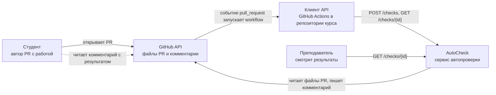
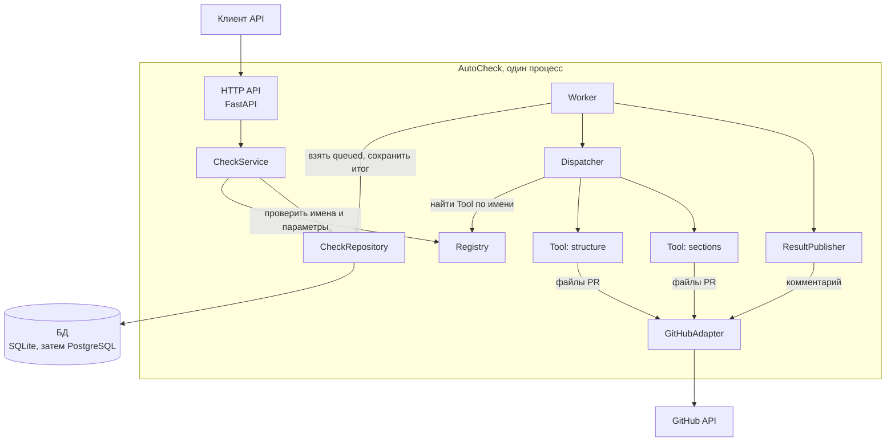

# Архитектура AutoCheck

Схемы в формате Mermaid, GitHub показывает их прямо на странице. Диаграмма состояний Проверки — в [job-states.md](job-states.md).

## Контекст

**Что показывают стрелки:** кто кого вызывает во время работы. Стрелка идёт от того, кто начинает запрос, к тому, кто его обрабатывает. Пунктир — студент не вызывает AutoCheck напрямую, он видит результат в PR.

**Границы системы:** база данных находится внутри AutoCheck, снаружи её не видно. Единственная внешняя зависимость по сети — GitHub API. Веб-интерфейса нет, результат виден в комментарии PR и через API.

## Компоненты

**Что показывают стрелки:** вызовы во время работы, от вызывающего к вызываемому.

**Зависимости кода идут иначе:** Dispatcher знает только интерфейс Tool из [tool-contract.md](tool-contract.md), а не конкретные классы. Tool получают файлы через интерфейс `PullRequestSource`, его реализует GitHubAdapter. Ядро — Check, Dispatcher, Registry, Tool — не импортирует FastAPI, SQLAlchemy и httpx. Поэтому новый Tool добавляется регистрацией в Registry без правки Dispatcher, а в тестах GitHubAdapter заменяется fake-реализацией.

## Ответственность компонентов

| Компонент | За что отвечает | Что скрывает от соседей |
|---|---|---|
| HTTP API | Принимает запросы, проверяет формат тела и заголовков, переводит исключения в единый формат ошибок | FastAPI, коды HTTP, сериализацию JSON |
| CheckService | Сценарии создания, чтения и отмены Проверки, идемпотентность повторного запроса | Как хранятся ключи идемпотентности и как сравниваются тела запросов |
| CheckRepository | Сохраняет и читает Проверки и результаты исполнителей | SQL, ORM, миграции, тип СУБД |
| Worker | Забирает Проверки в `queued`, запускает Dispatcher, переводит зависшие в `error` по таймауту | Способ получения задач: опрос таблицы в БД |
| Dispatcher | Запускает исполнителей по списку, собирает ToolResult, вычисляет итоговое состояние | Порядок запуска, правило "error важнее failed", перехват исключений Tool |
| Registry | Хранит соответствие имя → Tool и схему параметров каждого Tool | Какие Tool существуют и как они создаются |
| Tool: structure | Проверяет, что файлы PR лежат только в разрешённой папке | Правила сопоставления путей |
| Tool: sections | Проверяет, что все разделы шаблона есть и заполнены | Разбор Markdown и сравнение с шаблоном |
| ResultPublisher | Формирует текст комментария и публикует его в PR | Формат комментария, обработку сбоя публикации |
| GitHubAdapter | Получает файлы PR и публикует комментарий | HTTP, токен, timeout, повторы, постраничный обход, разбор некорректного ответа |
