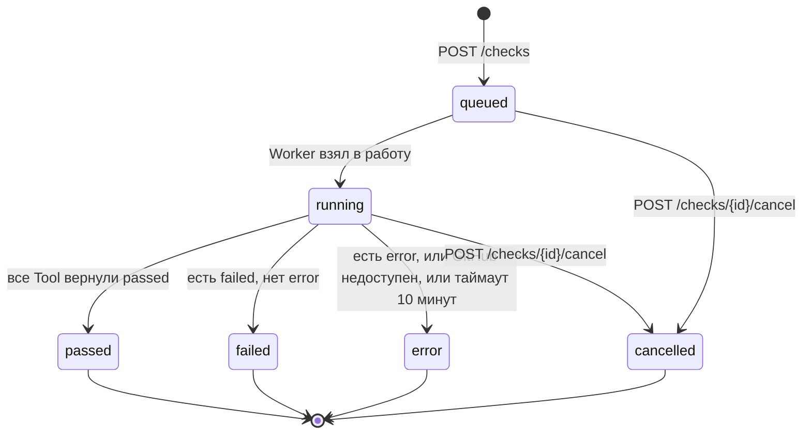

# Жизненный цикл Проверки

Проверка — единица работы AutoCheck (Job). Правила совпадают с разделом "Жизненный цикл" в [requirements.md](requirements.md).

## Диаграмма состояний

## Разрешённые переходы

| Из | В | Кто выполняет | Условие |
|---|---|---|---|
| — | `queued` | CheckService | Принят `POST /checks` |
| `queued` | `running` | Worker | Проверка взята в работу |
| `queued` | `cancelled` | CheckService | `POST /checks/{id}/cancel` |
| `running` | `passed` | Dispatcher | Все Tool вернули `passed` |
| `running` | `failed` | Dispatcher | Хотя бы один Tool вернул `failed`, ни один не вернул `error` |
| `running` | `error` | Dispatcher | Хотя бы один Tool вернул `error`: error важнее failed |
| `running` | `error` | Worker | Проверка в `running` дольше 10 минут, причина `timeout` |
| `running` | `cancelled` | CheckService | `POST /checks/{id}/cancel`, незапущенные Tool не запускаются, комментарий не пишется |

## Запрещённые переходы и ответ системы

| Попытка | Пример | Ответ системы |
|---|---|---|
| Любой переход из итогового состояния `passed`, `failed`, `error`, `cancelled` | Отмена уже пройденной Проверки | Через API: `409`, код `invalid_transition`, в `details` текущее состояние. Состояние не меняется |
| `queued` сразу в `passed`, `failed` или `error`, минуя `running` | Ошибка в коде Worker | Внутри сервиса: исключение `InvalidTransition`, состояние не меняется, запись уровня `ERROR` в лог |
| `running` обратно в `queued` | Попытка перезапустить Проверку | Исключение `InvalidTransition`. Повторная проверка — это новая Проверка через `POST /checks` |
| Повторный переход в то же состояние | Двойная отмена | Через API: `409 invalid_transition`, потому что `cancelled` итоговое |

## Порядок завершения

Сначала Проверка переходит в итоговое состояние и сохраняется, потом ResultPublisher пишет комментарий в PR. Поэтому отмена во время публикации комментария получает `409 invalid_transition`: Проверка уже завершена. Сбой публикации не меняет состояние, а ставит `comment_published = false`.

## После перезапуска сервиса

Проверки в `queued` лежат в БД и будут взяты в работу после старта. Проверки, которые были в `running`, Worker переведёт в `error` с причиной `timeout` через 10 минут после перехода в `running`, см. [ADR-0002](adr/0002-background-execution.md).

Почему 10 минут: это верхняя граница для зависшей Проверки, а не обычное время работы. `sections` читает каждый `.md` файл отдельным запросом, и на PR до 300 файлов при медленном GitHub (до 3 попыток по 5 секунд на запрос) выполнение может занять минуты. Когда Tool станет больше, например появится `llm_review`, таймаут пересмотрим.

Проверка переходов находится в самой модели Проверки, а не в API. Поэтому её нельзя обойти ни из HTTP, ни из Worker.
